<p align="center">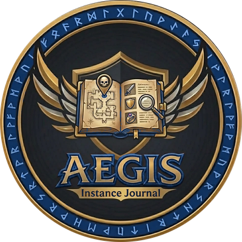</p>

# Aegis: Forever Instance Journal (v0.26.8)

**Retail's instance journal and dungeon maps, brought to WoW: Forever.**

[](https://discord.gg/Hr66t25vE7)
[](#install)
[](CHANGELOG.md)

Press **Shift+J** and the journal you know from retail opens: every dungeon and
raid, its bosses, loot, abilities, 3D models and quests, with maps that show
where each boss stands and an icon on the world map at every door.

> Built for **WoW: Forever** (the `_classic_beta_` client, Interface 16001).
> Not Classic Era. Not retail.

> ### 🚧 Work in progress
> The journal is still being built and filled in. Forever's own dungeons, raids
> and reputations join as they open and as players record them, and some data is
> still missing: a few boss spots and entrances, the damage abilities do, and the
> reputation rewards nobody has captured yet.
> Expect changes between versions: see the [changelog](CHANGELOG.md).

**[💬 Join the Discord](https://discord.gg/Hr66t25vE7)** for help, bug reports,
and to send in your recorded runs.

---

## Contents

- [What it does](#what-it-does): the journal, boss pages, maps, reputation, search and the Record tab
- [Santiago Reyes's maps](#santiago-reyess-maps)
- [Install](#install) · [Using it](#using-it)
- [A few honest notes](#a-few-honest-notes)
- [Under the hood](#under-the-hood)
- [Something broken?](#something-broken) · [Contributing](#contributing)

---

## What it does

### 📖 The journal

<p align="center">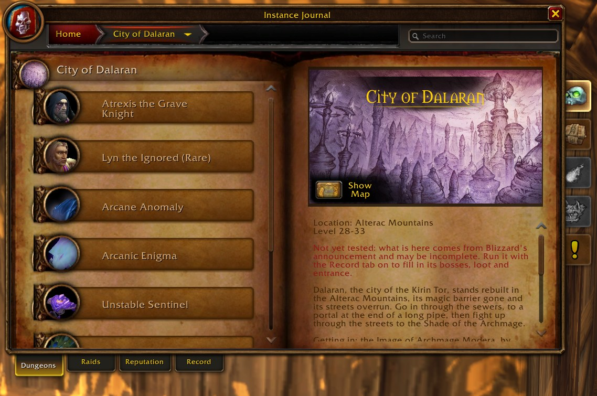</p>

- **Retail's Encounter Journal**, rebuilt to its measurements (Blizzard's own
  doesn't load on Forever): breadcrumb bar, search box, and four tabs:
  **Dungeons · Raids · Reputation · Record**.
- **35 dungeons**: the classics from Ragefire Chasm to Stratholme, Forever's own
  (The Hall of Thanes, Ruins of Lordaeron, Excavation Site: Wetlands, City of
  Dalaran), and the five Blizzard has announced.
- **3 raids, coming soon**: Barrow Deeps, Hyjal Summit and Onyxia's Lair.
- A **level-range filter**; **WoW: Forever's emblem** marks what Forever added;
  **Not yet tested** marks what still needs a recorded run.

### 🗡️ Boss pages

Five side tabs, as in retail, plus one:

- **Overview**: fight notes and quick facts.
- **Loot**: filter by class, armour and type (equipment by slot, recipes by
  profession, consumables, mounts, pets, toys), ★ favourites, pin an item to the
  map. Items the server doesn't know yet stay hidden until someone sees one drop.
- **Abilities**: retail's collapsible tree: what each ability does in the fight, its
  role alerts, stages, and the damage and timings your recorded runs measured.
- **Model**: the creature in 3D. Drag to turn it, scroll to zoom.
- **Quests**: the dungeon's quests with status icons and chains, their rewards,
  and **Show Start / Show End** to put a waypoint on the map.

| Overview | Loot | Abilities |
|:---:|:---:|:---:|
| 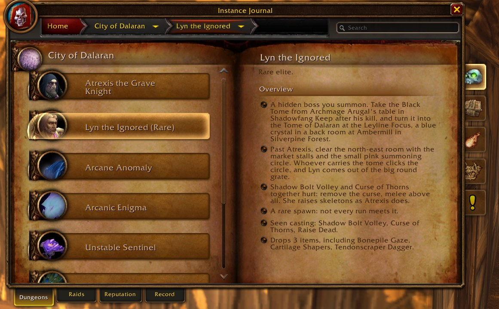 | 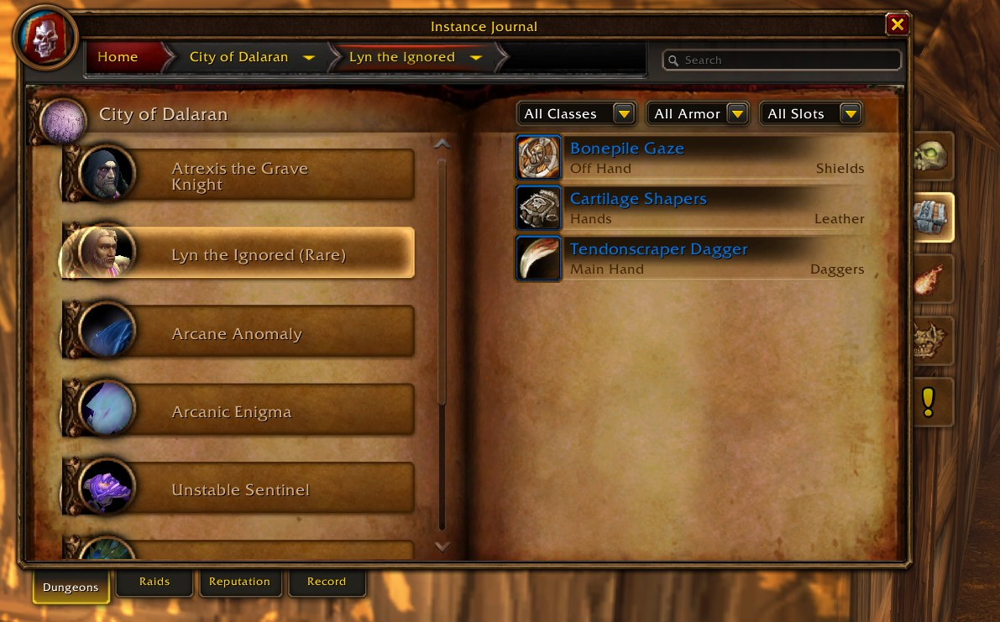 | 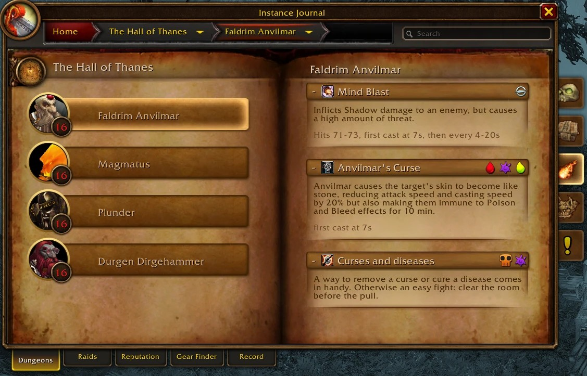 |
| **Model** | **Quests** | **Quests on the map** |
| 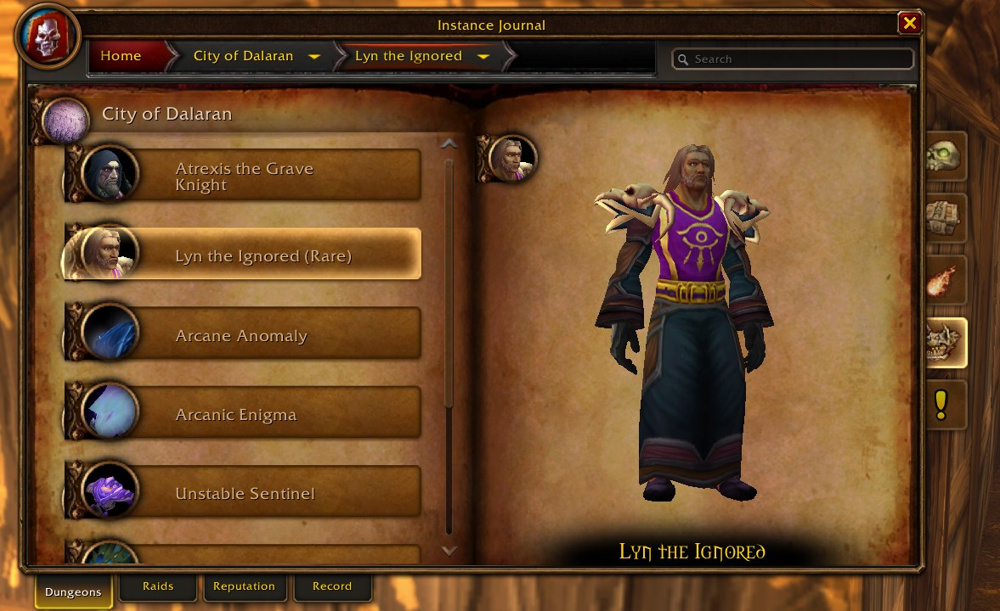 | 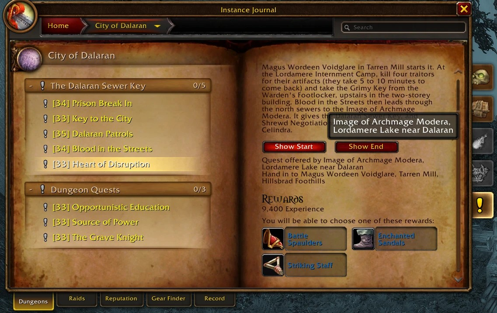 | 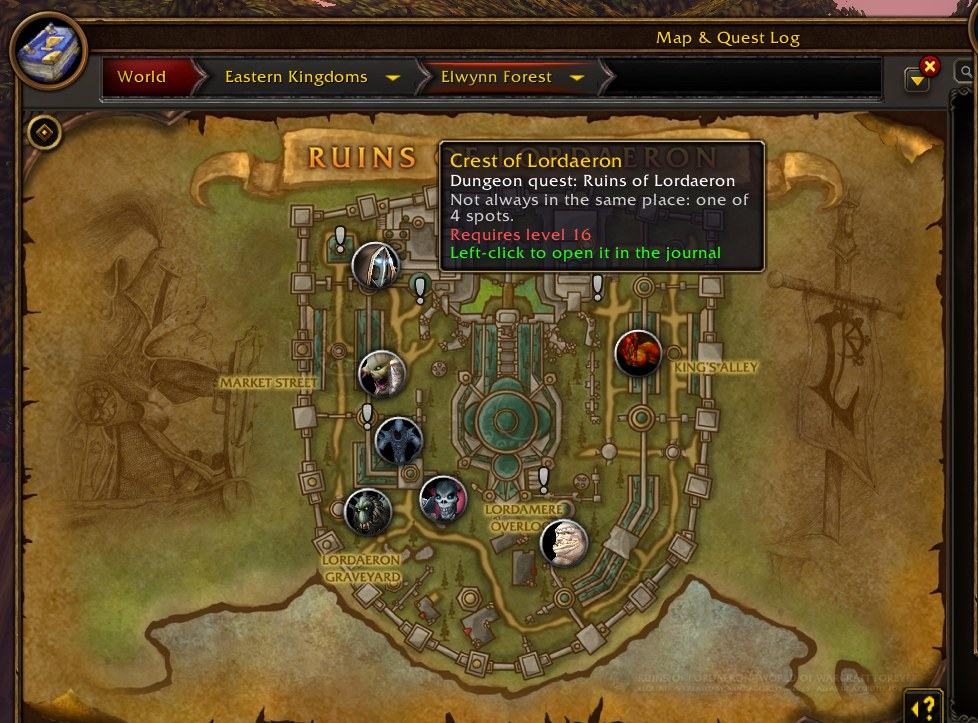 |

### 🗺️ Dungeon maps

- **Show Map**, or the world map inside a dungeon, draws its floors with retail's
  boss pins. Bosses you've killed are crossed out; the area you stand in glows.
- **A boss with several possible spots** gets small faded pins; hover one and
  all of its spots light up.
- **Forever's own dungeons** use Santiago Reyes's hand-drawn maps.
- **The places Blizzard never mapped**: Old Ironforge, the Defias Hideout on the
  way to the Deadmines, and the Deeprun Tram, with your arrow where the game
  gives a position.

| The Hall of Thanes | City of Dalaran, with the map legend | Old Ironforge |
|:---:|:---:|:---:|
| 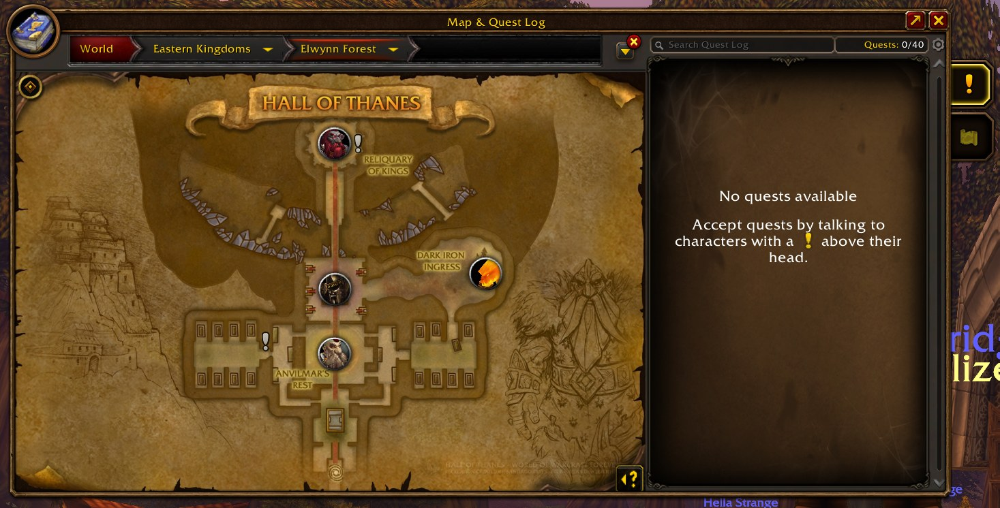 | 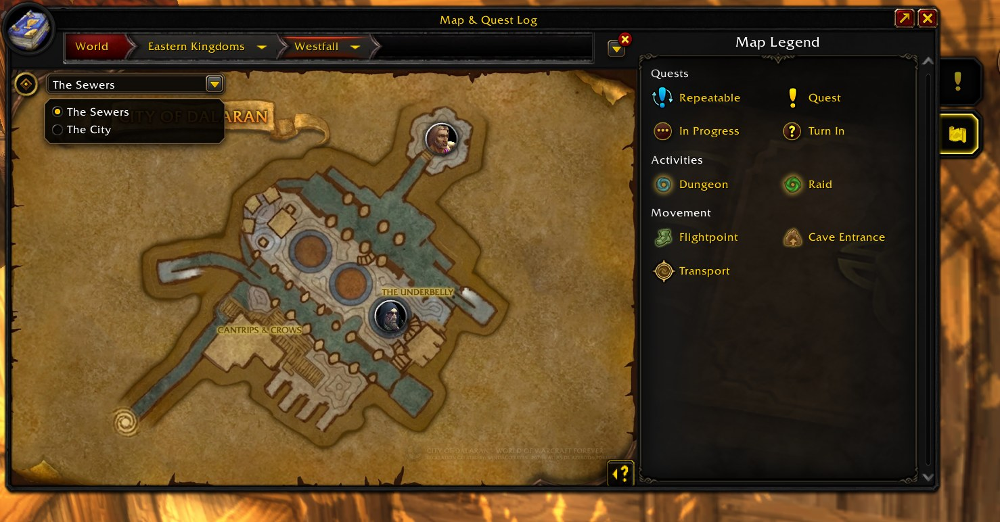 | 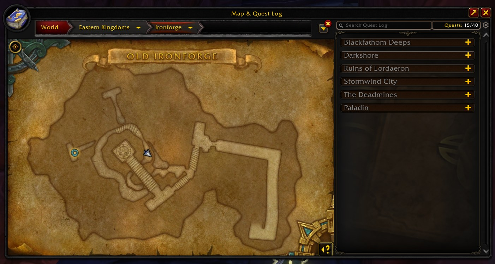 |

### 🧭 World map

- **Every dungeon and raid door**, with retail's portal icons: **left-click**
  opens the journal, **right-click** sets a waypoint. Wings that share a door
  (Scarlet Monastery, Blackrock Mountain) share one icon with a menu.
- **Flight masters** on zone maps, and the **boats, zeppelins, airships, trams
  and portals** where Forever actually put them.
- **Quest marks that follow your log**: **!** where an available quest starts,
  **?** where a finished one is handed in.
- The map's **Quests** and **Map Legend** tabs are back, and the legend lights
  up the journal's icons.

<p align="center">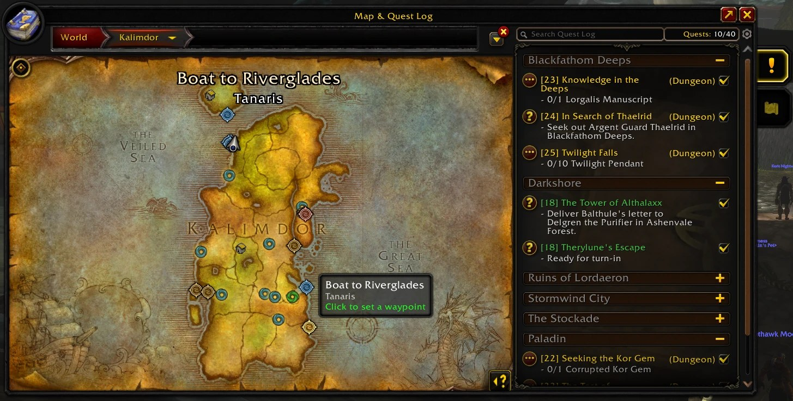</p>

### 🛡️ Reputation

- **A card per faction** with its crest and your standing.
- **Each standing's rewards**, filtered like loot, with what the quartermaster asks
  for each: gold, and any other cost.
- **Captured in game, first hand.** Open a quartermaster's shop, then press
  **Capture vendor** on the Reputation tab: every ware, its price and the standing
  it needs join the faction at once. A faction nobody has captured yet says so,
  and Forever's own factions say *Coming soon* until they open.

### 🔍 Search

Three letters find dungeons, bosses, abilities, loot, quests and factions. A
click opens the right page.

### 🔴 Record: help fill in Forever's journal

- **Starts by itself** when you enter a dungeon and stops when you leave, and
  writes the game's combat log there for boss abilities.
- **Notes what the journal needs**: entrances, area names, boss kills, every drop
  (your loot window, your group's loot and group rolls), quests from offer to
  hand-in, quartermasters' wares (or press **Capture vendor** at any shop), and
  travel spots you mark.
- **What you caught** lists what the journal doesn't have yet. **Copy** turns it
  into text to paste in our Discord, and your name goes on the contributors list.
- **The [Log Reader](https://torchlite-bit.github.io/Aegis_Forever_Instance_Journal/log-reader/)**
  adds the bosses' spells from your combat log to that text, in your browser.
  Addons can't see enemy casts in Forever's dungeons, but the log can.

### ⚡ Light on your game

No polling while it sits idle, and pages are built the first time you open
them. `/aegis perf` measures it in your own game.

---

## Santiago Reyes's maps

The maps of **The Hall of Thanes, Ruins of Lordaeron, Excavation Site: Wetlands
and City of Dalaran** are Santiago Reyes's, from his project *Atlas de Azeroth:
Forever*. They are his own reinterpretations, not official World of Warcraft art,
and he isn't affiliated with Blizzard. Showing them in a video or a stream?
Please credit him in its description. Never alter them or remove his watermark.

**Support his maps:**
[Patreon](https://www.patreon.com/c/SantiagoReyesMaps) ·
[Ko-fi](https://ko-fi.com/sr433_20)

---

## Install

1. Download the newest zip from
   [**Releases**](https://github.com/Torchlite-bit/Aegis_Forever_Instance_Journal/releases).
   The folder inside is already named `Aegis_Forever_Instance_Journal`.
2. Put the folder in `World of Warcraft/_classic_beta_/Interface/AddOns/`.
3. **Restart the client fully** (a `/reload` isn't enough the first time), then
   tick **Aegis Instance Journal** in the AddOns list.
4. Press **Shift+J**, or type `/aegis`.

Downloading the repo instead (**Code → Download ZIP**) works too, but **rename
the folder to exactly `Aegis_Forever_Instance_Journal`**: GitHub's ZIP unpacks as
`Aegis_Forever_Instance_Journal-main`, and the addon won't load under that name.

---

## Using it

| Do this | Get that |
|---|---|
| **Shift+J** or `/aegis` | Open or close the journal |
| `/aegis record` | Start or stop recording |
| `/aegis travel boat Auberdine` | Mark a boat, zeppelin, airship, tram or portal where you stand |
| `/aegis travel list` · `/aegis travel undo` | What you've marked · take back the last one |
| `/aegis where` | Print exactly where you stand |
| `/aegis items` | Find the journal's items the server doesn't have yet |
| `/aegis perf` | How much time and memory the journal uses |
| `/aegis reset` | Put the window back in its default place |

**Shift+J taken by another addon?** The journal offers to take it once, or set
your own key in **Key Bindings › AddOns › Toggle Instance Journal**.

---

## A few honest notes

- **Forever hides a lot inside its dungeons.** There's no player position there,
  so "you are here" comes from the area's name rather than an arrow.
- **The returning classic dungeons are new to Forever.** A few of their doors are
  only roughly placed, and some bosses have no spot on the map yet, until
  someone records a run.
- **Damage and timings come only from recorded runs.** Many bosses have none yet.
- **The announced dungeons and the raids** hold only what Blizzard has said so
  far. Their pages say *Coming soon*.

---

## Under the hood

```
Aegis_Forever_Instance_Journal/
├── Core/          registry, recorder, items, reputation, perf, compatibility
├── UI/            the journal window, its pages, and the map providers
├── Data/
│   ├── Instances/   each dungeon and raid: bosses, loot, quests, maps
│   ├── Authored/    notes, fixes and amendments written by hand
│   ├── Generated/   abilities and recorded fights (Tools/build_data.py)
│   ├── Reputation/  faction rewards
│   └── Travel/      boats, zeppelins, trams and portals
├── Media/         maps, raid pictures and the journal's own textures
├── Locales/       every string the journal shows
├── Tools/         build, test and packaging scripts (never shipped)
└── docs/          the README's pictures and the Log Reader page (never shipped)
```

Everything is the Forever client's own API, guarded where the client withholds
values. `python Tools/smoke_test.py` runs the whole addon against a mock client
and checks it; `--perf` measures it.

---

## Something broken?

1. Check the **version** in the AddOns list (`0.26.8`) and quote it.
2. A red line under **Recent** on the Record tab says what went wrong.
   Screenshot it.
3. Tell us on **[Discord](https://discord.gg/Hr66t25vE7)** or open an
   [issue](https://github.com/Torchlite-bit/Aegis_Forever_Instance_Journal/issues).

Recent changes are in [CHANGELOG.md](CHANGELOG.md).

---

## Contributing

**The easiest way to help is to play.** Leave the Record tab on, run a dungeon,
press **Copy**, then paste it on the
[**Log Reader**](https://torchlite-bit.github.io/Aegis_Forever_Instance_Journal/log-reader/)
with your combat log, which adds the bosses' spells. Post what it gives you in the
Discord. The page reads the log in your browser and never uploads it.

PRs are welcome too. Say hi on **[Discord](https://discord.gg/Hr66t25vE7)** first
if you're planning something big.

1. Keep `python Tools/smoke_test.py` passing: every push and pull request runs it.
2. Bump the version in the `.toc`, this file's **H1** and "Check the version"
   line, and add a [`CHANGELOG.md`](CHANGELOG.md) entry.
3. A new `.lua` file or texture needs a full client restart: say so in the
   changelog.

**Releases are automatic.** Every push to `main` publishes a release named
after the `.toc` version, with the addon zip and that version's changelog entry.
A push that keeps the version refreshes that release's zip. Each new version also
goes to CurseForge, once: bump the version for CurseForge to get a new file.

## License

The code is MIT. See [LICENSE](LICENSE). Santiago Reyes's maps are his and are
not covered by it. World of Warcraft, its art and its game data are Blizzard
Entertainment's; this addon is not made or endorsed by Blizzard.

---

<div align="center">

**[💬 Discord](https://discord.gg/Hr66t25vE7)** · **[📜 Changelog](CHANGELOG.md)** · **[🐛 Issues](https://github.com/Torchlite-bit/Aegis_Forever_Instance_Journal/issues)** · **[📄 Credits](CREDITS.md)**

*Aegis: Forever Instance Journal is part of the Aegis addon series. Good hunting.* ⚔️

</div>
