

# Aegis: Forever Instance Journal (v0.38.0)

**Retail's instance journal and dungeon maps, brought to WoW: Forever.**

Press **Shift+J** and the journal you know from retail opens: every dungeon and
raid, its bosses, loot, abilities, 3D models and quests, with maps that show
where each boss stands and an icon on the world map at every door.

> Built for **WoW: Forever** (the `_classic_beta_` client, Interface 16001).
> Not Classic Era. Not retail.

> ### 🚧 Work in progress
> The journal is still being built and filled in. Forever's own dungeons, raids
> and reputations join as they open and as players record them, and some data is
> still missing: a few boss spots and entrances, the damage abilities do, and the
> reputation rewards nobody has captured yet.
> Expect changes between versions: see the [changelog](CHANGELOG.md).

**[💬 Join the Discord](https://discord.gg/Hr66t25vE7)** for help, bug reports,
and to send in your recorded runs.

---

## Contents

- [What it does](#what-it-does): the journal, boss pages, maps, reputation, the Gear Finder, search and the Record tab
- [Santiago Reyes's maps](#santiago-reyess-maps)
- [Install](#install)
- [A few honest notes](#a-few-honest-notes)
- [Something broken?](#something-broken)

---

## What it does

### 📖 The journal

| Dungeons | City of Dalaran |
|:---:|:---:|
| 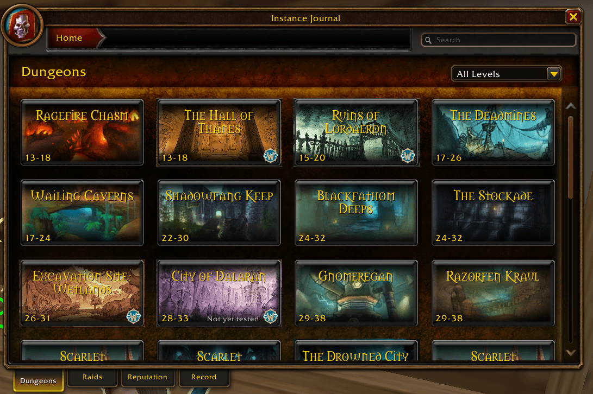 |  |

- **Retail's Encounter Journal**, rebuilt to its measurements (Blizzard's own
  doesn't load on Forever): breadcrumb bar, search box, and five tabs:
  **Dungeons · Raids · Reputation · Gear Finder · Record**.
- **35 dungeons**: the classics from Ragefire Chasm to Stratholme, Forever's own
  (The Hall of Thanes, Ruins of Lordaeron, Excavation Site: Wetlands, City of
  Dalaran), and the five Blizzard has announced.
- **3 raids, coming soon**: Barrow Deeps, Hyjal Summit and Onyxia's Lair.
- A **level-range filter**; **WoW: Forever's emblem** marks what Forever added;
  **Not yet tested** marks what still needs a recorded run.
- **Docked like the game's own windows**: it opens at the top left and moves aside
  when one of them opens there. Drag it anywhere until it closes, or untick docking
  in its options to have it open where you last left it.
- **Where it drops**: an item's tooltip names the boss and dungeon that drop it,
  wherever you see the item.

### 🗡️ Boss pages

Five side tabs, as in retail, plus one:

- **Overview**: fight notes and quick facts.
- **Loot**: filter by class, armour and type (equipment by slot, recipes by
  profession, consumables, mounts, pets, toys), ★ favourites, pin an item to the
  map. Items the server doesn't know yet stay hidden until someone sees one drop.
- **Abilities**: retail's collapsible tree: what each ability does in the fight, its
  role alerts, stages, and the damage and timings your recorded runs measured.
- **Model**: the creature in 3D. Drag to turn it, scroll to zoom.
- **Quests**: the dungeon's quests with status icons and chains, their rewards,
  and **Show Start / Show End** to put a waypoint on the map.

| Overview | Loot | Abilities |
|:---:|:---:|:---:|
| 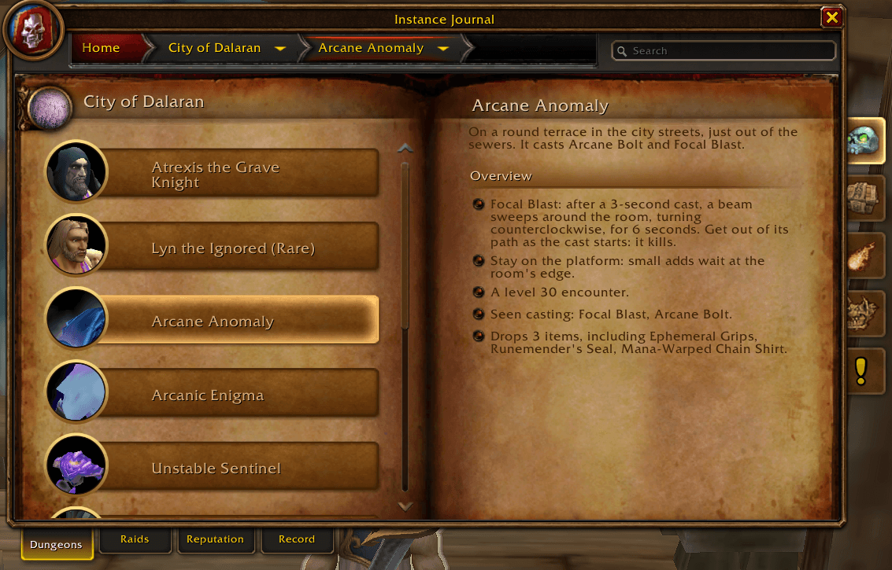 | 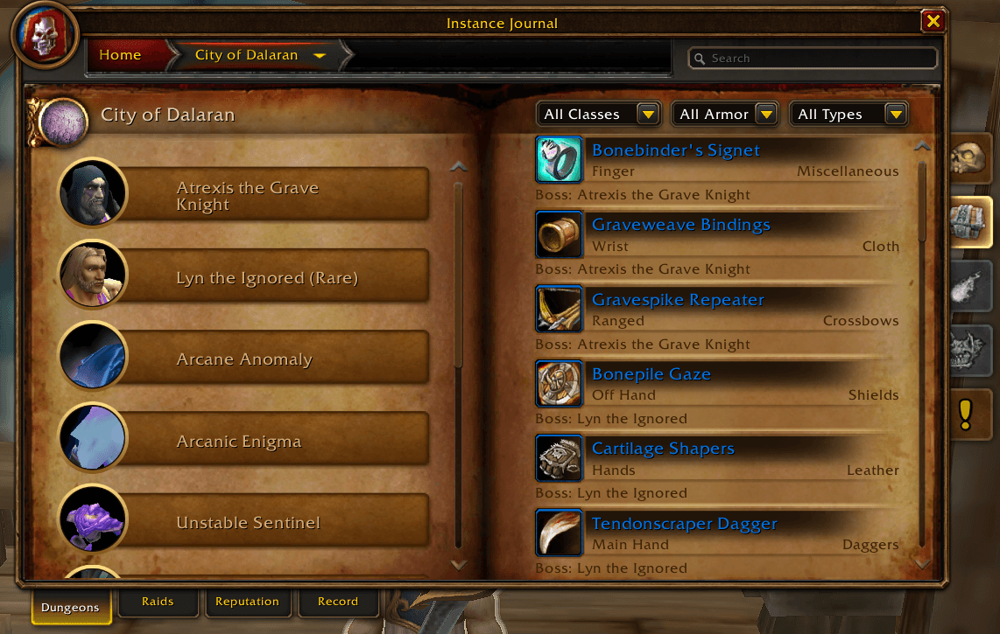 |  |
| **Model** | **Quests** | **Quests on the map** |
| 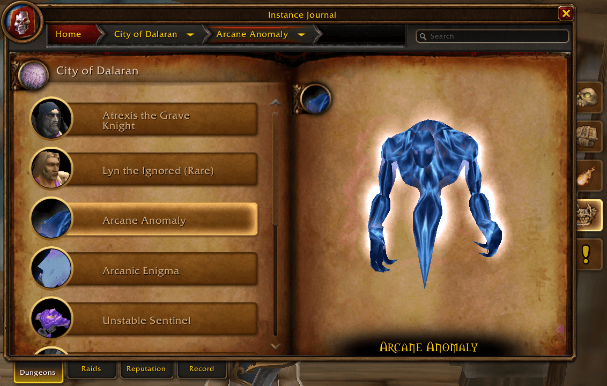 |  |  |

### 🗺️ Dungeon maps

- **Show Map**, or the world map inside a dungeon, draws its floors with retail's
  boss pins. Bosses you've killed are crossed out; the area you stand in glows.
- **A boss with several possible spots** gets small faded pins; hover one and
  all of its spots light up.
- **Forever's own dungeons** use Santiago Reyes's hand-drawn maps.
- **The places the game has no map of**: Old Ironforge, the Defias Hideout on the
  way to the Deadmines, and the Deeprun Tram, with your arrow where the game
  gives a position.

| The Hall of Thanes | City of Dalaran, with the map legend | Old Ironforge |
|:---:|:---:|:---:|
|  | 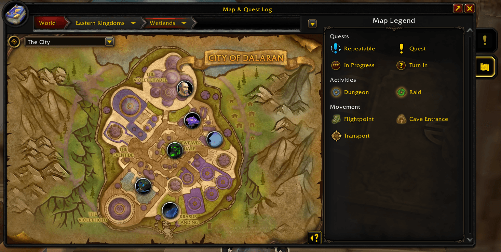 |  |

### 🏰 Maps of the ways in

Several of the caves, halls and ruins between a zone and a dungeon's door have
maps of their own. Walk in and the world map changes to them, with your arrow and
the dungeon doors on it; walk out and it changes back. Click a cave or entrance icon on the zone map to
look inside before you go.

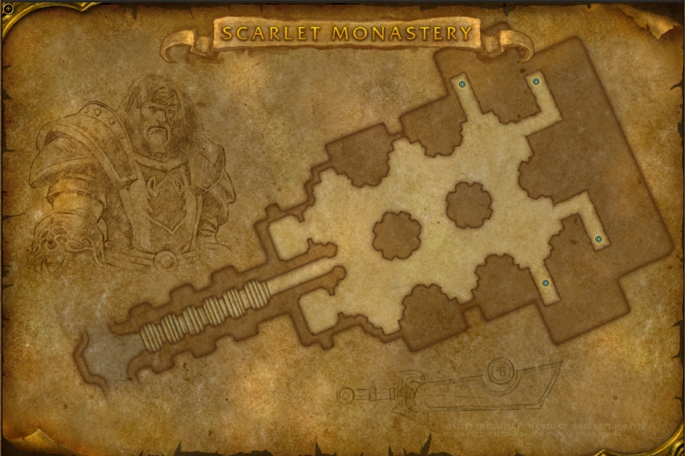

<em>The Scarlet Monastery's hall, redrawn by Torchlite for the classic four wings.</em>

- **Redrawn for the journal** from Blizzard's map: the Scarlet Monastery's hall,
  its passages to the Cathedral and the Armory drawn back in, a door at each wing's portal, and
  sketches of a Scarlet crusader and the Ashbringer. More are on the way.
- **Blizzard's own drawn maps**: the Wailing Caverns' cave, Uldaman's dig,
  Maraudon's two caves, Blackrock Mountain's two levels and the ruins of Dire Maul.
- **Blackrock Mountain's levels** are one more step of the map's location bar:
  pick the Spire's ring or the level down to the Depths.

| Dire Maul's ruins, with your arrow | Blackrock Mountain, its levels in the location bar | Feralas: the wings' doors and the way into the ruins |
|:---:|:---:|:---:|
| 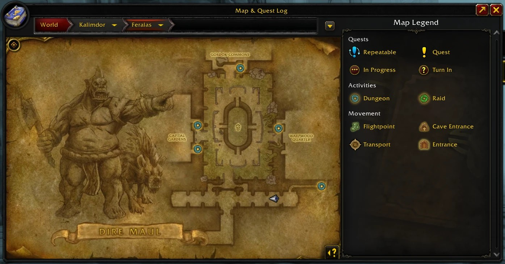 | 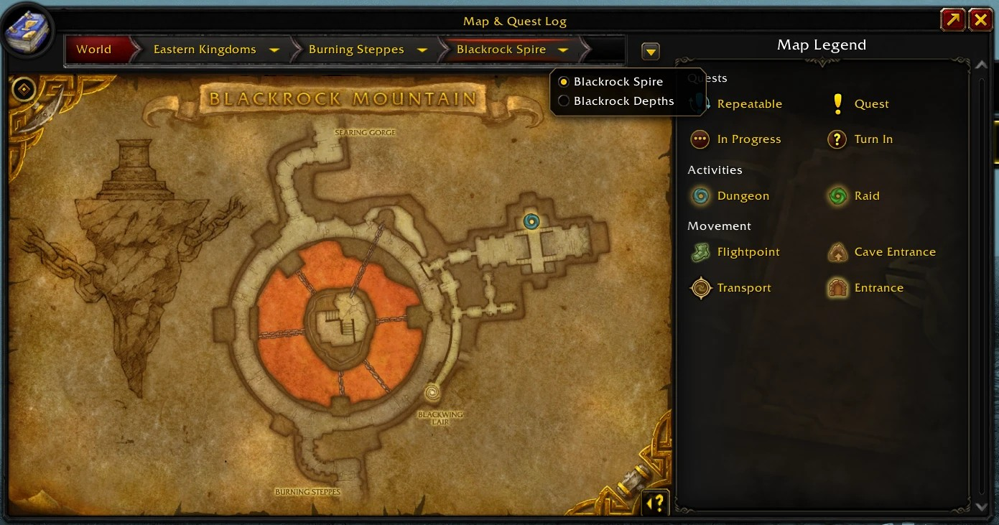 | 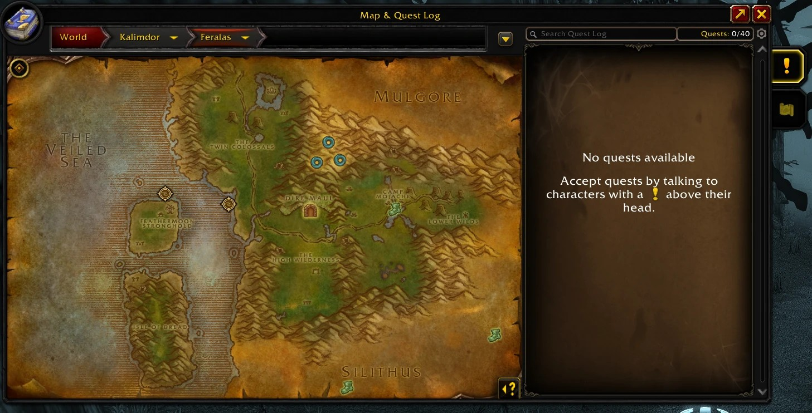 |

### 🧭 World map

- **Every dungeon and raid door**, with retail's portal icons: **left-click**
  opens the journal, **right-click** sets a waypoint. Wings that share a door
  (Scarlet Monastery, Blackrock Mountain) share one icon with a menu.
- **Cave and building entrances** mark the ways in, each with its own switch in
  the legend. A dungeon's floors, and Blackrock Mountain's levels, are one more
  step of the map's location bar.
- **Flight masters** on zone maps, and the **boats, zeppelins, airships, trams
  and portals** where Forever actually put them.
- **Quest marks that follow your log**: **!** where an available quest starts,
  **?** where a finished one is handed in.
- The map's **Quests** and **Map Legend** tabs are back, and the legend lights
  up the journal's icons.
- **Zone level ranges**: hover a zone on a continent map and its range shows
  after its name, coloured for your level, Forever's new zones included.
- **Show unexplored areas**: tick it in the map's filter menu (the magnifying
  glass) to see the parts of a zone you haven't explored yet, a little darker.

| Eastern Kingdoms, with the map legend | Riverglades: the filter menu's new choice |
|:---:|:---:|
| 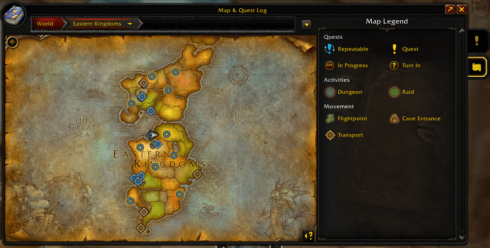 | 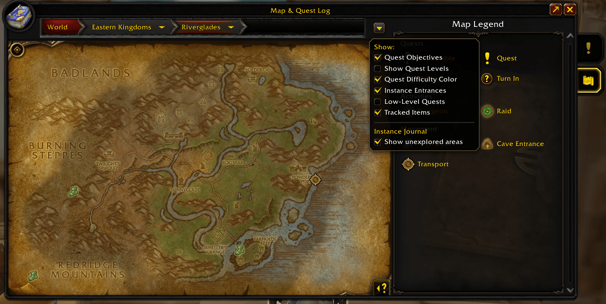 |

### 🛡️ Reputation

- **A card per faction** with its crest and your standing, and WoW: Forever's
  emblem on the factions it added.
- **Each standing's rewards**, filtered like loot, with what the quartermaster asks
  for each: gold, and any other cost.
- **Captured in game, first hand.** Open a quartermaster's shop, then press
  **Capture vendor** on the Reputation tab: every ware, its price and the standing
  it needs join the faction at once.
- **Until then, the game's own list.** A faction nobody has captured yet shows the
  rewards the game's item data lists for it, marked *unconfirmed* and without
  prices. A capture confirms each one it finds.

| Factions | A faction's rewards |
|:---:|:---:|
| 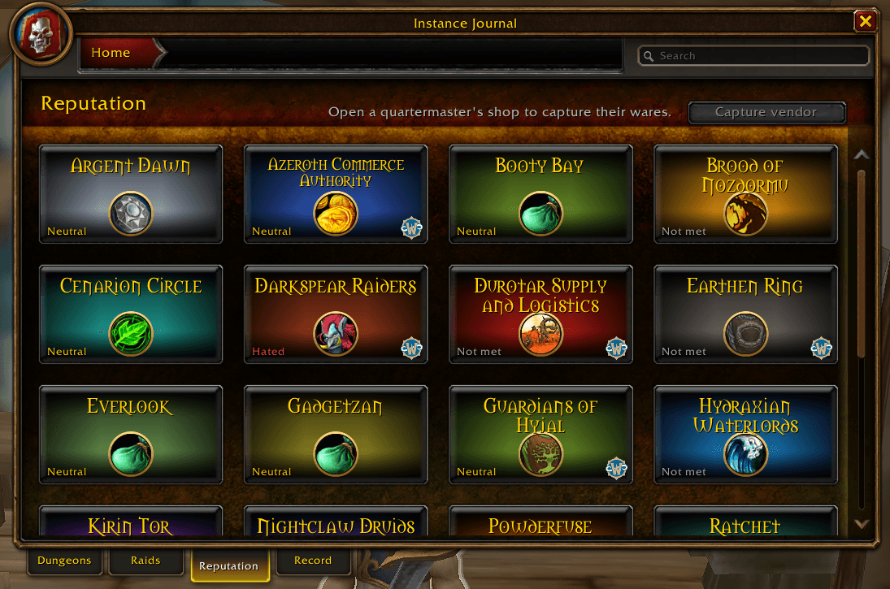 | 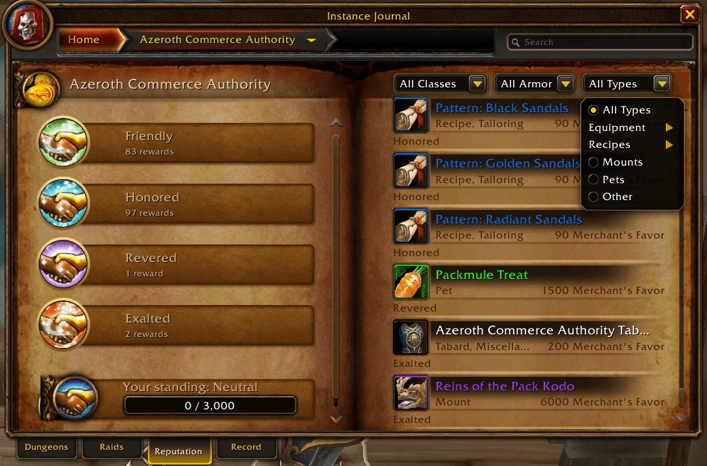 |

### 🎯 Gear Finder

- **The best upgrade for every slot** waiting in the dungeons near your level, laid
  out like your character sheet: each marked with what it adds to all the gear you
  wear, and where it drops.
- **Pick from the top 3**: click a slot to see its three biggest upgrades and choose
  the one you want there; your picks are kept for each character. Right-click opens
  an item's loot in the journal.
- **The dungeon that holds the most of them**, and the others with upgrades, one
  click apart.
- **Scored for your spec**: the one your talents say, or one you pick. Change any
  **stat weight** in game, or **bring in a scale from Pawn**; your weights are kept
  for each character.
- **Works with Pawn**: with Pawn installed, choose once whose stat weights both use.
  The journal's: Pawn shows them for your spec, so its tooltips and upgrade arrows
  agree with the Gear Finder. Pawn's: the Gear Finder scores with your Pawn scale.
- **On the character panel too**: its own tab turns the panel to your character,
  with your stat weights where the stats are, and a button to the Gear Finder.

| Gear Finder | Stat weights on the character panel |
|:---:|:---:|
| 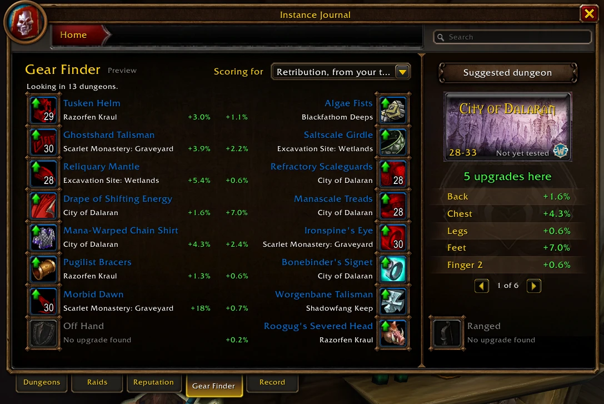 | 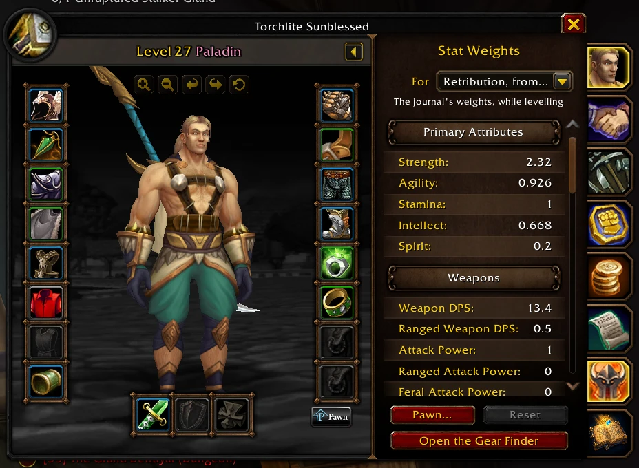 |

### 🔍 Search

Three letters find dungeons, bosses, abilities, loot, quests and factions. A
click opens the right page.

### 🔴 Record: help fill in Forever's journal

- **Starts by itself** when you enter a dungeon and stops when you leave, and
  writes the game's combat log there for boss abilities.
- **Notes what the journal needs**: entrances, area names, boss kills, every drop
  (your loot window, your group's loot and group rolls), quests from offer to
  hand-in, quartermasters' wares (or press **Capture vendor** at any shop), and
  travel spots you mark.
- **What you caught** lists what the journal doesn't have yet. **Copy** turns it
  into text to paste in our Discord, and your name goes on the contributors list.
- **The [Log Reader](https://torchlite-bit.github.io/Aegis_Forever_Instance_Journal/log-reader/)**
  adds the bosses' spells from your combat log to that text, in your browser.
  Addons can't see enemy casts in Forever's dungeons, but the log can.

### ⚡ Light on your game

No polling while it sits idle, and pages are built the first time you open
them. `/aegis perf` measures it in your own game.

---

## Santiago Reyes's maps

The maps of **The Hall of Thanes, Ruins of Lordaeron, Excavation Site: Wetlands
and City of Dalaran** are Santiago Reyes's, from his project *Atlas de Azeroth:
Forever*. They are his own reinterpretations, not official World of Warcraft art,
and he isn't affiliated with Blizzard. Showing them in a video or a stream?
Please credit him in its description. Never alter them or remove his watermark.

**Support his maps:**
[Patreon](https://www.patreon.com/c/SantiagoReyesMaps) ·
[Ko-fi](https://ko-fi.com/sr433_20)

---

## Install

1. Get it from
   [**CurseForge**](https://www.curseforge.com/wow/addons/aegis-forever-instance-journal)
   (the CurseForge app keeps it updated), or download the newest zip from
   [**Releases**](https://github.com/Torchlite-bit/Aegis_Forever_Instance_Journal/releases).
   The folder inside is already named `Aegis_Forever_Instance_Journal`.
2. Put the folder in `World of Warcraft/_classic_beta_/Interface/AddOns/`.
3. **Restart the client fully** (a `/reload` isn't enough the first time), then
   tick **Aegis Instance Journal** in the AddOns list.
4. Press **Shift+J**, or type `/aegis`.

Downloading the repo instead (**Code → Download ZIP**) works too, but **rename
the folder to exactly `Aegis_Forever_Instance_Journal`**: GitHub's ZIP unpacks as
`Aegis_Forever_Instance_Journal-main`, and the addon won't load under that name.

---

## A few honest notes

- **Forever hides a lot inside its dungeons.** There's no player position there,
  so "you are here" comes from the area's name rather than an arrow.
- **The returning classic dungeons are new to Forever.** A few of their doors are
  only roughly placed, and some bosses have no spot on the map yet, until
  someone records a run.
- **Damage and timings come only from recorded runs.** Many bosses have none yet.
- **The announced dungeons and the raids** hold only what Blizzard has said so
  far. Their pages say *Coming soon*.

---

## Something broken?

1. Check the **version** in the AddOns list (`0.38.0`) and quote it.
2. A red line under **Recent** on the Record tab says what went wrong.
   Screenshot it.
3. Tell us on **[Discord](https://discord.gg/Hr66t25vE7)** or open an
   [issue](https://github.com/Torchlite-bit/Aegis_Forever_Instance_Journal/issues).

Recent changes are in [CHANGELOG.md](CHANGELOG.md).

---

## License

The code is MIT. See [LICENSE](LICENSE). The maps are not covered by it:

- **Torchlite's maps**, each signed "Redrawn by Torchlite", are all rights reserved. They come
  with the addon, but using them anywhere else needs Torchlite's permission. See
  [LICENSE-MAPS.md](LICENSE-MAPS.md).
- **Santiago Reyes's maps** are his, used with his permission. See [CREDITS.md](CREDITS.md).

World of Warcraft, its art and its game data are Blizzard Entertainment's; this addon is not
made or endorsed by Blizzard.

---

**[💬 Discord](https://discord.gg/Hr66t25vE7)** · **[🔥 CurseForge](https://www.curseforge.com/wow/addons/aegis-forever-instance-journal)** · **[📜 Changelog](CHANGELOG.md)** · **[🐛 Issues](https://github.com/Torchlite-bit/Aegis_Forever_Instance_Journal/issues)** · **[📄 Credits](CREDITS.md)**

*Aegis: Forever Instance Journal is part of the Aegis addon series. Good hunting.* ⚔️

